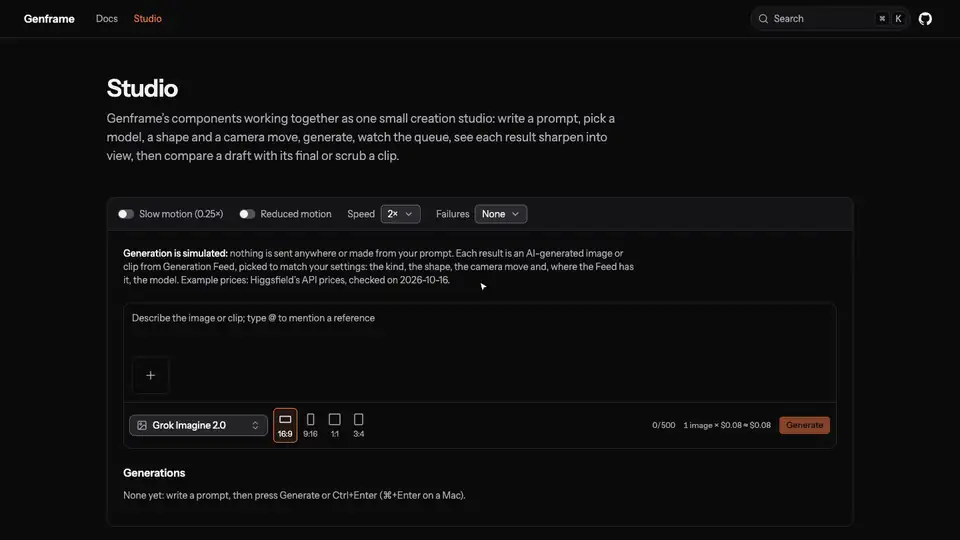
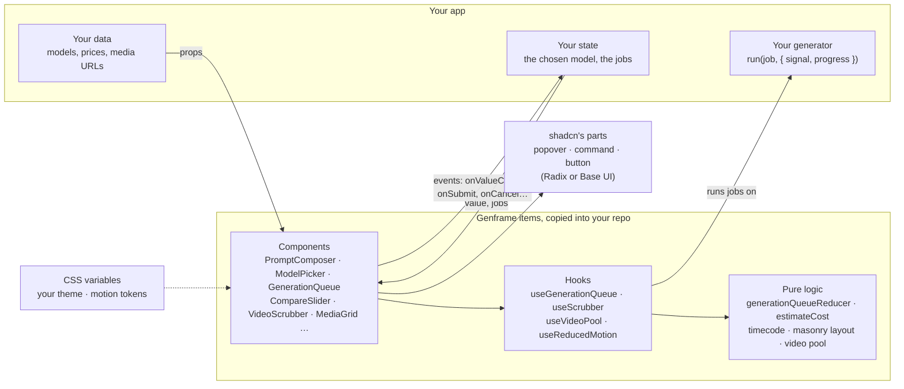

# Genframe

React components for AI image and video tools: a prompt box, model and aspect-ratio pickers, a
generation queue whose results sharpen out of grain, a before/after slider, a scrub bar and more.
Each installs into your shadcn app with one command, and each is accessible, tested and small.

**[Docs, with a live playground for every component](https://agzhxx.github.io/genframe/)** ·
**[The Studio](https://agzhxx.github.io/genframe/studio/)**, the components working together

<a href="https://agzhxx.github.io/genframe/studio/"></a>

```bash
npx shadcn@latest registry add @genframe=https://agzhxx.github.io/genframe/r/{name}.json
npx shadcn@latest add @genframe/compare-slider
```

**Used by** [Generation Feed](https://generation-feed.vercel.app), which installs `media-grid` and
`media-card` from this registry, and [Storyboard Timeline](https://storyboard-timeline.vercel.app),
whose clip picker installs `media-card`.

Independent project, not affiliated with Higgsfield.

## Items

| Item | Type | What it does | ARIA pattern | Size (gzip) | With its Genframe items |
| --- | --- | --- | --- | --- | --- |
| `compare-slider` | Component | A before/after slider for two images or two videos: drag, click or use the keys; two videos stay in step. | Slider | 2,902 B | 3,493 B |
| `aspect-ratio-picker` | Component | Pick an aspect ratio from frames drawn in their shapes; a preview frame changes shape with the pick, and disabled ratios say why. Compact for toolbars. | Radio group (native) | 1,801 B | 2,392 B |
| `model-picker` | Component | A searchable list of models with their badges and prices, and what a run with the current settings would cost ("5 s × $0.042 ≈ $0.21"). | Combobox + listbox | 2,593 B | 4,287 B |
| `prompt-composer` | Component | A prompt box for generation: text that grows, @-mentions of reference images (picked, dropped or pasted), preset chips, a character count, and a footer for your toolbar, the cost and submit. | Combobox pattern for mentions; checkboxes | 4,979 B | 5,570 B |
| `generation-queue` | Component | Generation jobs as cards in a list: their place in line and time left, progress, results; cards slide into their new places, and every change of state is announced. | List; polite live region | 2,009 B | 8,660 B |
| `generation-card` | Component | One job in each of its states: queued, running (or a calm pulse when progress is unknown), succeeded, failed, canceled and refunded, with its buttons. Its media keeps the requested shape from the start. | Article; progressbar | 2,581 B | 6,651 B |
| `denoise-reveal` | Component | An image that sharpens out of grain and blur once it has loaded, the way a diffusion model makes one. | Image | 1,037 B | 1,628 B |
| `media-grid` | Component | A virtualized masonry grid of images and clips: CSS places its first screen before any JavaScript runs, and clips preview from a shared pool of videos. | List | 2,966 B | 10,191 B |
| `media-card` | Component | An image or clip as a link or a button: its poster over a ThumbHash, and a preview while the pointer rests on it, or a play button. | Link or button; toggle button | 2,463 B | 6,493 B |
| `video-scrubber` | Component | A scrub bar for any video: the time played, buffered ranges, a preview of the time under the pointer from a sprite sheet with its timecode, and frame-step keys. | Slider | 1,476 B | 4,986 B |
| `camera-motion-picker` | Component | Pick a camera move from tiles that loop a clip of it on hover, keyboard focus or a tap, through the shared pool of videos; play buttons with reduced motion. | Radio group (native) | 1,905 B | 4,350 B |
| `use-generation-queue` | Hook | Runs the queue's jobs on your driver, a few at a time; knows nothing about any API, and stops everything on unmount. | | 986 B | 1,843 B |
| `use-video-pool` | Hook | One pool of videos for a page's previews, made after hydration, and the hook a card borrows one with. | | 611 B | 1,854 B |
| `use-scrubber` | Hook | A scrub bar's logic for any player: the slider pattern with the time in words, seeking by pointer and by frame that never jumps back, and `useMediaElement` to wire a `<video>`. | | 2,125 B | 2,919 B |
| `use-thumbhash` | Hook | A ThumbHash as a placeholder data URL or its average color, decoded on the server too. Brings `thumbhash`. | | 1,585 B | 1,585 B |
| `use-reduced-motion` | Hook | Tells components whether to reduce motion: the user's system setting, or your app's own through `ReducedMotionProvider`. | | 364 B | 364 B |
| `generation-queue-reducer` | Lib | The queue's state as a pure reducer that ignores late events (progress after a cancel, a success after a retry), with selectors for the place in line and the time left. | | 857 B | 857 B |
| `simulated-generator` | Lib | A pretend generator for demos and tests: seeded, so the same jobs run the same way every time. | | 712 B | 2,555 B |
| `estimate-cost` | Lib | What a generation will cost, from a model's price and the run's settings: exact decimal arithmetic, rounded once, and in words. | | 1,103 B | 1,103 B |
| `video-pool` | Lib | A fixed set of `<video>` elements that cards borrow for previews: never more than its size, the least recently used taken back first. | | 1,243 B | 1,243 B |
| `masonry-layout` | Lib | Masonry math that places cards by aspect ratio, so a server and the browser place them the same way at any width. | | 732 B | 732 B |
| `timecode` | Lib | Clock times and SMPTE timecode at any frame rate (23.976 and 29.97 exactly), frame-accurate seek times, and a time in words for screen readers. | | 794 B | 794 B |
| `motion-tokens` | CSS | The durations and easing curves that the animated components share, as CSS variables, a spring among them. | | 227 B | 227 B |

Sizes are each item's own code plus the npm packages it brings, minified and gzipped. Every item
has a budget, and CI fails when one grows past it. The last column adds the other Genframe items
an item brings, theirs too: what installing it adds to an app that has none yet. The shadcn parts
an item builds on aren't counted; ModelPicker's `command` brings cmdk, 4.7 KB gzip in a Radix app.
A test measures every item and checks this table.

Requirements: React 19, Tailwind CSS v4 and a shadcn project in a Radix or Base UI style (shadcn's
default). Items with Genframe dependencies need the namespace mapped, as above, even when added by
URL. [Getting started](https://agzhxx.github.io/genframe/docs/) has the details.

## Why a kit for generation tools

Image and video generators all need the same handful of parts, and none of them is a form control
you can take off the shelf: a prompt box that knows about reference images, a model list with
prices and what this run will cost, an aspect-ratio choice, a queue whose jobs wait, run, fail and
finish, a way to compare a draft with its final, a scrub bar for the clips that come out.

When this started, none of the 443 registries in shadcn's directory was a kit for that (it lists 479
today, still none). The closest describe themselves as "AI and media-rich interfaces" or "media
editors", and the AI kits that exist (Vercel's AI Elements, prompt-kit, assistant-ui) are for chat:
a prompt box, but no presets, aspect ratios, model prices, queue with progress, before/after or
camera moves. Depth wins here: a few components done thoroughly are worth more than many shallow
ones.

## Principles

- **Accessible.** Every interactive part follows its WAI-ARIA pattern, works fully by keyboard and
  publishes its keyboard map, which the tests run key by key.
- **Motion explains state.** Animation shows what changed: a result sharpening into view, a card
  sliding to its new place, a handle springing to a click. Nothing is decorative, only transforms
  and opacity move (plus the reveal's blur), and every animation has a reduced-motion version.
- **Small.** Each item has a size budget, checked in CI, and brings only the packages it needs: one
  in the whole Kit, `thumbhash`.
- **Data in, events out.** No fetching, no global state, no hard-coded URLs or prices, no Next.js
  imports: models, media URLs and the generator come in as props, and changes go out through
  callbacks. Every item installs and builds in a Vite app as well as in Next.js.
- **Yours to change.** Items arrive as source in your repo, on shadcn's own parts and theme
  variables, so they look like the rest of your app.

## How the components are built

Each component is a thin skin over logic that knows nothing about markup. The pure parts
(`generation-queue-reducer`, `estimate-cost`, `timecode`, `masonry-layout`, `video-pool`) are plain
functions, tested on their own. The hooks (`use-generation-queue`, `use-scrubber`, `use-video-pool`,
`use-reduced-motion`, `use-thumbhash`) hold behavior and state and work with any markup. The
components put them on shadcn's parts with Tailwind classes on shadcn's theme variables.



The generation queue shows the split best. A pure reducer holds the jobs and decides what each
event does, ignoring events that arrive late (progress after a cancel, an old attempt's success
after a retry). A hook runs it on a driver, a single function that returns a promise and reports
progress, so a real backend replaces the simulated generator without touching a component. The
queue and its cards only draw jobs and send clicks back.

## Three decisions, and what they beat

1. **A shadcn registry, not an npm package.** A component kit is mostly markup, styles and motion,
   which every app wants to adjust; as source in the app's repo, they can be, and nothing updates
   under it. Each item still has one source of truth here, with tests, a budget and a page. Rejected
   for now: an npm package, which ships updates to many apps at once but makes every change of
   markup a fork. A headless npm core for the queue, scrubber and pool logic is on the list for
   when two apps need the same fix.
2. **Radix style, built on shadcn's own parts.** `shadcn init` now defaults to Base UI. Tested with
   shadcn 4.22.1: an item written in Radix style on shadcn's `popover` installs in Base UI apps too
   (the CLI rewrites `asChild` to `render`), while one written in Base UI style breaks in Radix apps.
   So items import shadcn's parts, and each app gets the version for its own primitives. Rejected:
   Base UI style, and importing primitives directly (a Base UI app would carry two layers). React
   Aria styles aren't supported yet.
3. **CSS for motion, not Motion.** Transitions on `transform` and `opacity`, timed by CSS variables
   that any app can retime; a spring written as a CSS `linear()` curve; cards that slide with a FLIP
   in about 450 bytes. Rejected: Motion with LazyMotion, about 4.6 KB for the spring alone (more than
   the slider), with animation running in JavaScript, outside the tokens and the reduced-motion
   setting an app can override.

## Tests

- 927 unit and component tests (Vitest). Unit tests for every piece of logic: the reducer from every
  state with every event, late events included; money arithmetic; mentions; timecode at frame
  boundaries; the slider's and the scrubber's arithmetic; the masonry lanes; the video pool against a
  model of its rules over 2,000 random steps.
- Component tests for every component (Testing Library and user-event in jsdom): roles and states,
  the whole keyboard map, focus, live-region messages, both motion versions, and controlled and
  uncontrolled use wherever a component holds a value.
- End-to-end tests in Google Chrome on the built site, served the way GitHub Pages serves it: every
  page without console errors and with axe, the spec's flows (drag and keys, filter and choose, an
  @-mention and submit, a job from the line to its opened result, a long grid that never exceeds its
  pool, frame-exact seeking), reduced motion, and screenshots of key states compared on Linux.
- **The install test**: every item installed with `shadcn add` into two fresh shadcn apps, one Base UI
  and one Radix, then `tsc` and `vite build` there. It proves the Kit works for people who aren't me,
  and it caught a bug nothing else could (the shadcn CLI matches imports by file name).
- Lighthouse CI on four pages, and the size check, in every CI run. Pushes to `main` deploy only when
  everything passes.

## Accessibility

Sliders, radio groups, comboboxes with `aria-activedescendant`, a progressbar, a polite live region:
each component's page names its WAI-ARIA pattern, renders its tested keyboard map and says what screen
readers hear. When a focused element goes away (a removed card or reference, a closed result), focus
moves on to the next sensible place, never to the page's body; disabled choices say why; and reduced
motion is a calmer version, not no feedback. axe (4.14) finds no critical or serious
issue on any of the site's 28 pages or in 14 states that only appear after an interaction (open
lists, empty searches, jobs failing, results opened, previews playing, a phone's width), checked by
`node scripts/axe-report.ts`; the 70 moderate findings are in the docs' layout (Fumadocs), not the
components. That audit found two real bugs in M8, both fixed with a test that fails on the old code.

## The numbers

Measured on the built site in Google Chrome, as of 0.1.0; how, and before and after each change, in
[docs/PERF.md](docs/PERF.md).

| Goal | Target | Measured |
| --- | --- | --- |
| Installable anywhere | Every item installs, typechecks and builds in a fresh shadcn app | 23 of 23 items, in a Base UI app and a Radix app, in every CI run |
| Small | Each item within its budget | 23 of 23, from 227 B to 4,979 B gzip |
| Accessible | No serious axe issue on any docs page | 0 critical and 0 serious on 28 pages and in 14 interactive states |
| Smooth | 60 fps; INP ≤ 100 ms on the playgrounds | With the CPU slowed 4×: frames at 16.7 ms (median) in every scenario; INP under 100 ms in 9 of 10 (24 to 88 ms; the Studio 56 to 64 ms). ModelPicker's first opening misses, at 112 to 192 ms (72 ms unthrottled) |
| Fast docs | LCP ≤ 2.5 s on a phone (lab) | 1.7 to 1.9 s with Chrome throttled to Lighthouse's mobile network and CPU; 3.2 to 3.3 s by Lighthouse's default estimate, which counts the docs framework's scripts as blocking the paint |
| Used for real | The Feed and the Timeline install from the Kit | Both pull requests pass their tests; not merged yet |

Why the two misses stand: Lighthouse's default LCP is an estimate that counts every script requested
before the first paint as blocking it, and Next.js asks for all of them at once, where Chrome really
throttled paints at 1.7 to 1.9 s; ModelPicker's first opening pays for code running for the first
time, and the changes tried didn't bring it reliably under 100 ms. The details are in
[docs/PERF.md](docs/PERF.md).

## Known limits

ModelPicker's first opening on a slow phone, the docs' Lighthouse LCP estimate, the docs layout's
moderate axe findings, no React Aria styles yet, and file headers that shadcn's CLI drops on
install.

## Credits and licenses

- Genframe's code is MIT-licensed ([LICENSE](LICENSE)).
- Built on [shadcn/ui](https://ui.shadcn.com)'s parts and CLI, [Radix](https://www.radix-ui.com)
  (or Base UI, in apps that use it), [cmdk](https://cmdk.paco.me) under shadcn's `command`, and
  Evan Wallace's [thumbhash](https://github.com/evanw/thumbhash), all MIT-licensed.
- The docs site: [Next.js](https://nextjs.org), [Fumadocs](https://fumadocs.dev) and
  [Tailwind CSS](https://tailwindcss.com) (MIT). The font is
  [Instrument Sans](https://github.com/Instrument/instrument-sans) (SIL Open Font License 1.1).
- `media-grid`, `media-card` and the video pool come from my
  [Generation Feed](https://generation-feed.vercel.app), made generic here.
- The demos' images and clips are AI-generated, from Generation Feed, made with Higgsfield's public
  API. They're served from the Feed's storage, not stored here; the scrub bar's thumbnail sprites in
  `public/sprites/` are made from them. The demos' model prices are examples: Higgsfield's API prices
  as the Feed recorded them, checked on 2026-10-16.

## Development

Node 24 and pnpm.

```bash
pnpm install
pnpm dev            # http://localhost:3000/genframe/
pnpm build          # the registry's JSON (public/r), the size check, then the static site (out/)
pnpm test           # unit and component tests
pnpm test:e2e       # end-to-end tests on the built site, in Google Chrome
pnpm test:install   # every item into fresh shadcn apps (Base UI and Radix), then tsc and vite build
pnpm lighthouse     # Lighthouse CI on four pages of the built site
```

| Command | What it measures (after `pnpm build`) |
| --- | --- |
| `pnpm sizes` | Each item's gzip size against its budget |
| `node scripts/page-weights.ts` | The JS and CSS each page loads |
| `node scripts/first-load.ts` | A page's first load on a slowed phone: FCP, LCP, layout shift, when it responds |
| `node scripts/interactions.ts` | INP and frames on the playgrounds and the Studio, with the CPU slowed 4× |
| `node scripts/axe-report.ts` | axe at every impact on every page and in states that need an interaction |
| `node scripts/reveal-cost.ts` | The denoise reveal's frames and paint, from a Chrome trace |
| `node scripts/record-studio.ts` | Records the Studio: an MP4 for posts and the WebP above |

Numbers: [docs/PERF.md](docs/PERF.md). Releases: [CHANGELOG.md](CHANGELOG.md). Design hand-off
(tokens for Figma, screenshots of the components): [docs/design/](docs/design/README.md).
